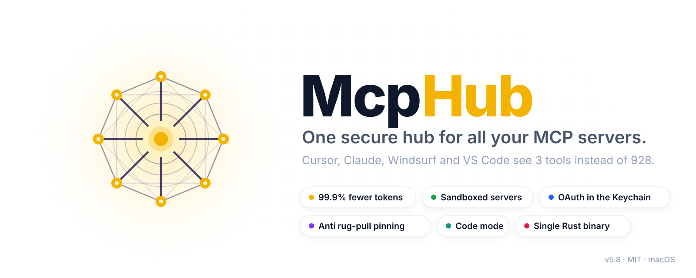
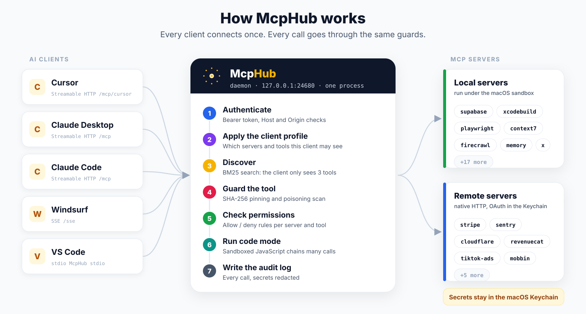
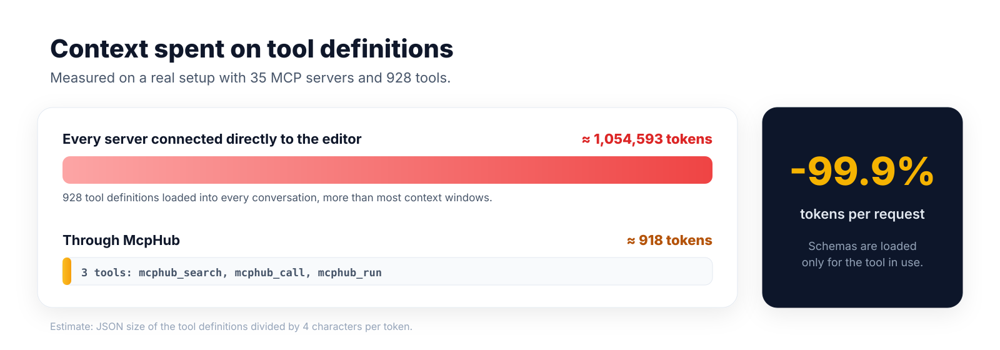
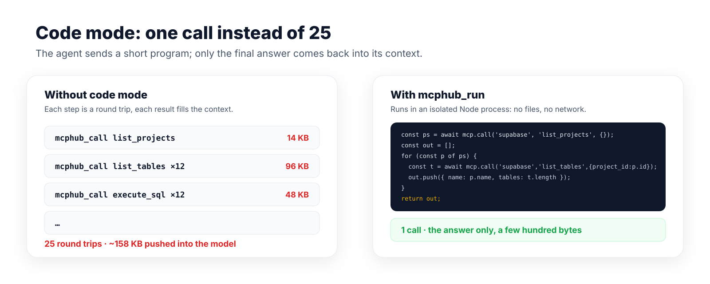
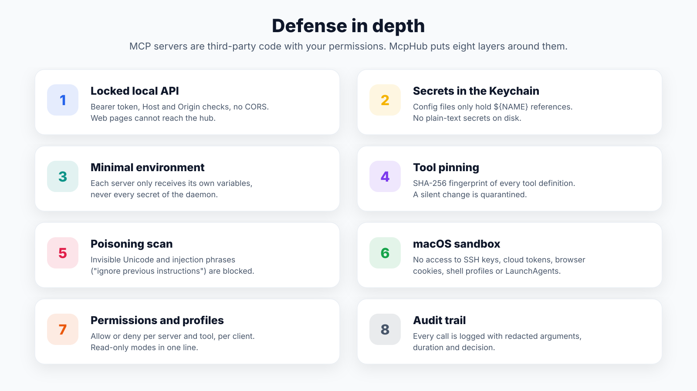
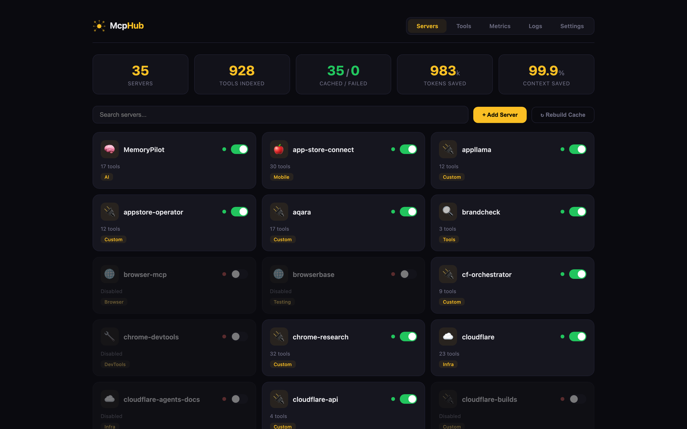
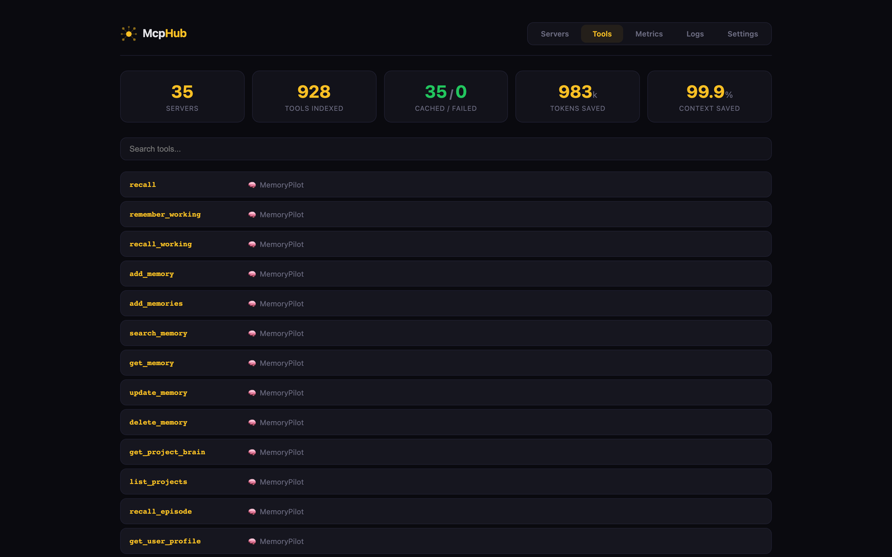
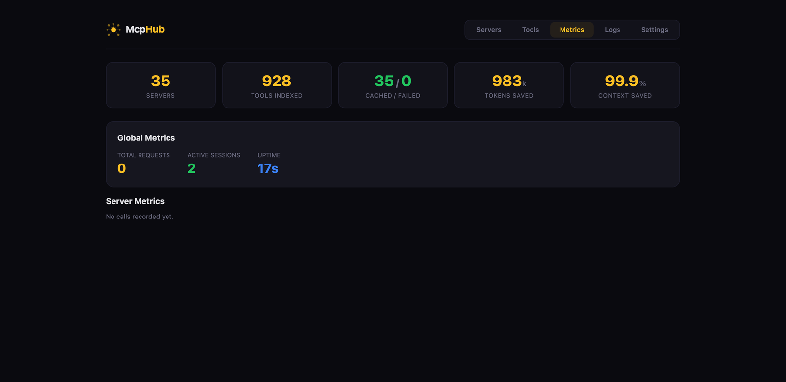

<p align="center">
  
</p>

<p align="center">
  <a href="https://github.com/Soflutionltd/McpHub/releases/latest/download/McpHub-macos-universal.tar.gz"></a>
  &nbsp;
  <a href="#-install-in-one-line"></a>
</p>

<p align="center">
  <a href="https://github.com/Soflutionltd/McpHub/releases/latest"></a>
  
  
  
  
</p>

<p align="center">
  <b>McpHub</b> sits between your AI editors and all your MCP servers.<br/>
  Your agents see <b>3 tools instead of hundreds</b>, every call goes through <b>the same security guards</b>,<br/>
  and your servers run <b>once, sandboxed</b>, shared by Cursor, Claude, Windsurf and VS Code.
</p>

<p align="center">
  <a href="#-install-in-one-line">Install</a> ·
  <a href="#-connect-your-editor">Connect your editor</a> ·
  <a href="#-how-it-works">How it works</a> ·
  <a href="#-code-mode">Code mode</a> ·
  <a href="#%EF%B8%8F-security">Security</a> ·
  <a href="#-dashboard">Dashboard</a> ·
  <a href="#-library">Library</a> ·
  <a href="#-linux-servers-and-sync">Linux and sync</a> ·
  <a href="#%EF%B8%8F-configuration">Configuration</a> ·
  <a href="#-faq">FAQ</a>
</p>

---

## ✨ At a glance

<table>
  <tr>
    <td align="center" width="25%"><h3>-99.9%</h3>tokens spent on tool definitions<br/><sub>1,054,593 → 918 on a 928-tool setup</sub></td>
    <td align="center" width="25%"><h3>1 process</h3>for every editor<br/><sub>servers start once, survive editor restarts</sub></td>
    <td align="center" width="25%"><h3>8 layers</h3>of security<br/><sub>Keychain, pinning, sandbox, audit...</sub></td>
    <td align="center" width="25%"><h3>0 runtime</h3>dependencies<br/><sub>a single signed Rust binary</sub></td>
  </tr>
</table>

| | Each server wired into each editor | **Through McpHub** |
|---|---|---|
| Tool definitions in every prompt | all of them (hundreds of thousands of tokens) | **3 tools**, schemas loaded on demand |
| Server processes | one copy per editor | **one shared copy** |
| Secrets | plain text in every editor config | **macOS Keychain**, `${NAME}` references |
| A server silently changes a tool | nobody notices | **quarantined** until you approve |
| A malicious npm server reads `~/.ssh` | it can | **blocked by the macOS sandbox** |
| Remote servers with OAuth | one `mcp-remote` process each, tokens in plain files | **native HTTP**, tokens in the Keychain, auto refresh |
| Who called what | unknown | **audit log** with redacted arguments |
| Finding a new server | search GitHub, copy a JSON snippet, paste a token | **Library** of the official MCP Registry: trust score, one-click add, secrets straight to the Keychain |
| Your agent needs a tool you lack | you install it by hand | the agent **installs it itself** from the registry, sandboxed, if it is trusted enough |
| A second machine, a Linux server | redo everything, copy tokens around | **same binary**, bubblewrap sandbox, **encrypted sync** of servers and secrets |

---

## 🚀 Install in one line

```bash
curl -fsSL https://raw.githubusercontent.com/Soflutionltd/McpHub/main/get.sh | bash
```

The script downloads the latest binary for your machine (signed universal binary on macOS, x64 or arm64 on Linux), verifies its SHA-256 checksum and installs it to `~/.local/bin/McpHub`. Then:

```bash
McpHub dashboard  # Library tab: add servers from the official MCP Registry (or McpHub add)
McpHub generate   # index every tool once
McpHub install    # start the daemon at login (LaunchAgent on macOS, systemd --user on Linux)
```

<details>
<summary><b>Manual download</b></summary>

1. Download [`McpHub-macos-universal.tar.gz`](https://github.com/Soflutionltd/McpHub/releases/latest/download/McpHub-macos-universal.tar.gz) and its [checksum](https://github.com/Soflutionltd/McpHub/releases/latest/download/McpHub-macos-universal.tar.gz.sha256).
2. `shasum -a 256 -c McpHub-macos-universal.tar.gz.sha256`
3. `tar -xzf McpHub-macos-universal.tar.gz && install -m 755 McpHub ~/.local/bin/McpHub`
4. Downloaded through a browser? Clear the quarantine flag: `xattr -d com.apple.quarantine ~/.local/bin/McpHub`

Linux (amd64, arm64) and Windows (amd64) archives are attached to [every release](https://github.com/Soflutionltd/McpHub/releases/latest) too. On Linux the sandbox uses bubblewrap and secrets live in `~/.McpHub/secrets.env` (mode 600, hidden from sandboxed servers), see [Linux servers and sync](#-linux-servers-and-sync). Windows has no sandbox.

</details>

<details>
<summary><b>Build from source</b></summary>

```bash
git clone https://github.com/Soflutionltd/McpHub.git
cd McpHub
make install      # cargo build --release, install, sign
```

`make install` signs with your Developer ID certificate when one is present, so macOS keeps its permissions from one version to the next. Linux and Windows build from source (`cargo build --release`); the macOS sandbox and Keychain features are macOS only.

</details>

---

## 🔌 Connect your editor

The daemon listens on `http://127.0.0.1:24680`. Your token is in `~/.McpHub/auth-token`.

<details open>
<summary><b>Cursor</b>, <code>~/.cursor/mcp.json</code></summary>

```json
{
  "mcpServers": {
    "McpHub": {
      "url": "http://127.0.0.1:24680/mcp",
      "headers": { "Authorization": "Bearer <your-token>" }
    }
  }
}
```

</details>

<details>
<summary><b>Claude Code</b></summary>

```bash
claude mcp add --transport http mcphub http://127.0.0.1:24680/mcp \
  --header "Authorization: Bearer $(cat ~/.McpHub/auth-token)"
```

</details>

<details>
<summary><b>Claude Desktop</b>, <code>claude_desktop_config.json</code></summary>

```json
{
  "mcpServers": {
    "McpHub": { "command": "/Users/you/.local/bin/McpHub", "args": ["stdio"] }
  }
}
```

</details>

<details>
<summary><b>VS Code</b>, <code>.vscode/mcp.json</code></summary>

```json
{
  "servers": {
    "mcphub": {
      "type": "http",
      "url": "http://127.0.0.1:24680/mcp",
      "headers": { "Authorization": "Bearer <your-token>" }
    }
  }
}
```

</details>

<details>
<summary><b>Windsurf and other SSE clients</b></summary>

Use `http://127.0.0.1:24680/sse` with the same `Authorization` header.

</details>

**One profile per client.** Give each editor its own view: `http://127.0.0.1:24680/mcp/cursor` only shows what the `cursor` profile allows (see [Profiles](#profiles-per-client)).

### Project-aware client (optional)

`client/` is a small Node MCP server that sits between your editor and the daemon. It talks to the running daemon (SSE, token from `~/.McpHub/auth-token`) and falls back to `McpHub stdio`. It exposes six tools:

- `mcphub_bootstrap`: call once per conversation. Resolves the project from the workspace, returns its aliases and allowed servers, and recalls compact [MemoryPilot](https://github.com/Soflutionltd/MemoryPilot) context, also for folders without a project entry.
- `mcphub_search`, `mcphub_call`: same as the daemon, plus suggestions on a misspelled tool or server, and the input schema on argument errors.
- `mcphub_batch`: up to 20 independent calls in one round-trip.
- `mcphub_status`, `mcphub_savings`: server health and an honest context-size comparison.

Per-project policy lives in `~/.McpHub/projects.json` (or the path in `MCPHUB_PROJECTS`), see [`client/projects.example.json`](client/projects.example.json). For a workspace listed there, only its `allowedServers` are reachable, and a call aimed at another Supabase project, App Store app or Cloudflare project is refused. Without the file there is no policy; an unreadable file is an error, never silently ignored.

```bash
cd client && npm ci
```

```json
{
  "mcpServers": {
    "McpHub": { "command": "node", "args": ["/path/to/McpHub/client/index.js"] }
  }
}
```

`npm test` runs smoke tests against the local daemon (MemoryPilot and supabase configured), with a throwaway project file.

### Working on client accounts

Connecting to a client's Stripe (or Supabase, Cloudflare…) should not log you out of your own, and your own agent should never reach theirs by mistake. Two levels, from light to strict:

**1. Client-owned servers (same McpHub).** Add the client's server under its own name (`stripe-acme`, with its own OAuth token or restricted key, since tokens are stored per server name) and list it in the client project's `ownedServers`:

```json
"acme": {
  "workspaces": ["/Users/you/Clients/Acme"],
  "aliases": { "product": "Acme" },
  "allowedServers": ["MemoryPilot", "context7"],
  "ownedServers": ["stripe-acme"]
}
```

An owned server only answers, appears in `mcphub_search` and in `mcphub_status` when `working_dir` is inside that client's workspace; the `project` argument alone is not enough. A server owned by two projects is a start-up error. This guard lives in the Node client: an editor connected straight to the daemon still sees every server, so give it a profile with `"excludeServers": ["*-acme"]`.

**2. A separate instance (nothing shared).** For clients who require it, run a second McpHub with its own folder, port, Keychain service, auth token and LaunchAgent:

```bash
export MCPHUB_INSTANCE=acme MCPHUB_PORT=24690
McpHub add                 # writes ~/.McpHub-acme/config.json
McpHub oauth login stripe  # token stored under Keychain service McpHub-acme
McpHub install             # LaunchAgent com.soflution.mcphub.acme
```

A named instance never imports the servers declared in your editors, refuses the main port (24680), and its token is rejected by the main daemon (and the other way round). Point the editor of that client's workspace at it with the same variables:

```json
"McpHub": {
  "command": "node",
  "args": ["/path/to/McpHub/client/index.js"],
  "env": { "MCPHUB_INSTANCE": "acme", "MCPHUB_PORT": "24690" }
}
```

`MCPHUB_HOME` and `MCPHUB_VAULT_SERVICE` override the folder and the Keychain service. Sandboxed servers of every instance are denied all `~/.McpHub*` folders. Automatic start of a named instance is supported on macOS and Linux.

---

## 🧭 How it works

<p align="center"></p>

1. Your editor connects once to the McpHub daemon (Streamable HTTP, SSE or stdio).
2. The agent sees three tools: `mcphub_search` (BM25 search over every tool), `mcphub_call` (run one tool) and `mcphub_run` (code mode).
3. Each call is authenticated, filtered by the client profile, checked against the tool pins and permissions, then routed to the right server, which is started on demand and stopped when idle.
4. Local servers run under the macOS sandbox with a minimal environment; remote servers are reached directly over HTTP with OAuth tokens kept in the Keychain.
5. Every call lands in the audit log.

### Token savings

<p align="center"></p>

Wiring dozens of MCP servers straight into an editor loads every tool schema into every conversation. On the setup above (35 servers, 928 tools) that is over a million tokens, more than any context window. McpHub replaces it with three small tools and loads a schema only when the agent actually needs it.

---

## 🧠 Code mode

<p align="center"></p>

For multi-step or bulk work, the agent sends a short JavaScript program with `mcphub_run`:

```js
const projects = await mcp.call("supabase", "list_projects", {});
const unhealthy = projects.filter(p => p.status !== "ACTIVE_HEALTHY");
return unhealthy.map(p => p.name);
```

- `mcp.call(server, tool, args)` returns the tool result, `mcp.search(query)` finds tools, `console.log` is captured.
- The program runs in a separate Node.js process (22.13 or newer) started with `--permission`: no files, no network, no subprocesses, inside a macOS sandbox.
- Its only way out is `mcp.call`, which goes through every McpHub guard (permissions, quarantine, profiles, audit).
- Limits: `settings.codeMode` → `{ "timeoutSecs": 60, "maxCalls": 100 }`, output capped at 1 MB.

---

## 🛡️ Security

<p align="center"></p>

MCP servers are third-party programs, often fetched on the fly with `npx -y package@latest`, running with your permissions. McpHub treats them accordingly.

<details open>
<summary><b>Locked local API</b></summary>

- `/mcp`, `/sse`, `/message` and every `/api/*` route require `Authorization: Bearer <token>` (a 256-bit random token in `~/.McpHub/auth-token`, mode 600).
- Requests whose `Host` is not `127.0.0.1`, `localhost` or `[::1]` are refused (DNS rebinding), as are requests with a foreign `Origin`. No CORS headers: a web page cannot call the hub.
- The dashboard opens through a one-time link (`McpHub dashboard`) and keeps a per-session secret, never the main token.

</details>

<details>
<summary><b>Secrets in the macOS Keychain</b></summary>

```bash
McpHub vault set GITHUB_TOKEN      # masked prompt, stored in the Keychain
McpHub vault migrate               # move an existing secrets.env into the Keychain
```

`config.json` only holds `${GITHUB_TOKEN}` references. Each server process starts with a minimal environment (system variables, its own `env`, and the names listed in `inheritEnv`), so no server ever receives the secrets of the others.

</details>

<details>
<summary><b>Tool pinning and poisoning detection</b></summary>

The first time McpHub sees a server, it records a SHA-256 fingerprint of every tool (name, description, input and output schemas, annotations) in `~/.McpHub/tool-pins.json`. If a server later changes a definition (a "rug pull"), the tool is quarantined: hidden from the catalog and refused on call, until you check it:

```bash
McpHub pins status                  # what is quarantined and why
McpHub pins approve SERVER [TOOL]   # accept the new definition
McpHub pins scan                    # scan every cached tool, read-only
```

Descriptions and schemas are scanned for invisible Unicode and classic injection phrases ("ignore previous instructions", "do not tell the user", `~/.ssh/id_rsa`, `mcp.json`...). New tools appearing on an approved server are held back too.

```json
"settings": { "toolSecurity": { "pinning": "block", "scan": "block", "newTools": "block" } }
```

With `"pinning": "off"` (or `"warn"`), changed definitions are accepted automatically but scanned again: a new description that trips the scan is still blocked when `scan` is `block`.

</details>

<details>
<summary><b>Server isolation (macOS sandbox)</b></summary>

```json
"settings": { "sandbox": "shield" }
```

`shield` runs every local server under `sandbox-exec`. Servers keep working normally but cannot read or write SSH and GPG keys, cloud and GitHub credentials, browser profiles and cookies, Claude/Cursor configs, shell profiles, LaunchAgents or McpHub's own files, and cannot run `security`, `launchctl`, `osascript` or `open`. A secret file that a server references in its own `env` or `args` (an App Store `.p8` key, for example) stays readable.

Per server: `"sandbox": false`, `"strict"` (no writes outside temp folders and caches), or `{ "mode": "strict", "network": false, "allowWrite": ["~/data"], "allowExec": ["open"] }`.

```bash
McpHub sandbox                 # effective isolation of every server
McpHub sandbox show supabase   # the generated profile
```

The sandbox is a strong barrier against credential theft by a compromised package, not a full container.

</details>

<details>
<summary><b>Permissions, confirmations and audit</b></summary>

```json
"permissions": {
  "default": "allow",
  "rules": [
    { "server": "supabase", "tool": "delete_*", "action": "deny", "reason": "production" },
    { "server": "stripe", "tool": "*", "action": "confirm" }
  ]
}
```

- `deny` blocks a tool, `confirm` asks a human first through a native macOS dialog that the agent cannot answer. `autoClassify: true` applies `confirm` to every destructive tool (by name and by the MCP `destructiveHint` annotation).
- `McpHub policy test SERVER TOOL` shows which rule applies.
- `McpHub audit --tail 50` shows the last calls, with secrets redacted, in `~/.McpHub/audit.jsonl` (rotated).

</details>

---

## 🌐 Remote servers and shared OAuth

```json
"sentry":  { "url": "https://mcp.sentry.dev/mcp" },
"aqara":   { "url": "https://agent.aqara.com/open/mcp", "headers": { "Authorization": "Bearer ${AQARA_API_KEY}" } }
```

Remote servers are reached directly over Streamable HTTP, without an `mcp-remote` process per server. McpHub implements the MCP authorization spec: discovery (RFC 9728 and 8414), dynamic client registration, PKCE, resource indicators, automatic refresh, HTTPS only, tokens bound to the server URL and stored in the Keychain.

```bash
McpHub oauth status            # connection state of every remote server
McpHub oauth login sentry      # sign in through the browser, once
McpHub oauth logout sentry
McpHub oauth migrate --apply   # convert "npx mcp-remote URL" entries, keeping their tokens
```

---

## 📊 Dashboard

Run `McpHub dashboard` (a one-time link opens your browser).

<table>
  <tr>
    <td width="50%"><p align="center"><sub>Servers: status, tools, enable or disable in one click</sub></p></td>
    <td width="50%"><p align="center"><sub>Every indexed tool, searchable</sub></p></td>
  </tr>
  <tr>
    <td width="50%"><p align="center"><sub>Calls, errors and latency per server</sub></p></td>
    <td width="50%" valign="top">
      <ul>
        <li>Add, edit, enable and disable servers</li>
        <li>Live logs with filters</li>
        <li>Rebuild the tool cache in one click</li>
        <li>Real token savings counter</li>
        <li>One-click diagnosis of a failing server</li>
      </ul>
    </td>
  </tr>
</table>

---

## 📚 Library

The **Library** tab of the dashboard is the official [MCP Registry](https://registry.modelcontextprotocol.io) inside McpHub: search thousands of servers, read a trust score, click **Add**.

- **Search runs locally.** The first time you open the Library, McpHub downloads the catalog once in the background (the popular servers from the [GitHub MCP Registry](https://github.com/mcp) come first, in a few seconds; the full official catalog follows) into `~/.McpHub/registry-cache/`. After that, it only fetches what changed, at most once a day. Search is instant and works offline.
- **Zero weight for your agent.** The catalog lives in the dashboard and on disk. It adds no tool definition to the agent's context and nothing stays in memory between searches.
- **Trust score before you install** (0 to 100), with the detail of every point:
  - verified publisher: the registry checks the namespace (a GitHub account or a DNS domain), McpHub checks that it publishes its own code;
  - popularity and activity: GitHub stars, last update, archived repositories;
  - permission scan: secrets requested, plain HTTP endpoints, privileged Docker options, bundle integrity hash, unpinned versions, and what the server can do (run commands, touch files, a browser, payments...).
- **One-click add** for every kind of server: remote (Streamable HTTP), npm (`npx`), Python (`uvx`), Docker, .NET (`dnx`) and `.mcpb` bundles (downloaded, SHA-256 checked, extracted outside `~/.McpHub`).
- **Secrets go to the Keychain**, never to `config.json`. A secret you already have (`GITHUB_TOKEN`...) is reused.
- **Remote servers sign in with McpHub's native OAuth** (one click on *Sign in*), tokens in the Keychain.
- **New servers inherit every guard**: shield sandbox for local code (Docker keeps its container), tool pinning and description scan on first contact, quarantine on change, audit log, permissions and profiles.

From the terminal: `McpHub registry search postgres`, `McpHub registry info NAME`, `McpHub registry install NAME`, `McpHub registry sync`.

### Your agent installs what it needs

No new tool is added for this (about 30 tokens in total). When `mcphub_search` finds nothing, the agent can call:

```text
mcphub_call  server=mcphub  tool=registry_search   arguments={"query": "postgres"}
mcphub_call  server=mcphub  tool=registry_install  arguments={"name": "io.github.acme/postgres-mcp"}
```

The server is installed with the same guards, its tools are indexed right away, and the call is audited. An agent never handles secrets: when a server needs one, the agent asks you to finish in the dashboard. Control it in `settings.registry`:

```json
"registry": { "agentInstall": "trusted", "minTrust": 60 }
```

`agentInstall`: `"trusted"` (default, only servers whose trust score reaches `minTrust`), `"any"` or `"off"`.

---

## 🐧 Linux servers and sync

McpHub runs the same way on a Linux server, for example next to an agent running on a VPS:

```bash
curl -fsSL https://raw.githubusercontent.com/Soflutionltd/McpHub/main/get.sh | bash
sudo apt install bubblewrap   # sandbox
McpHub install                # systemd --user service
```

- **Sandbox with bubblewrap**: same policy as on macOS. Every secret folder (`~/.ssh`, `~/.aws`, `~/.McpHub`...) is replaced by an empty folder in memory, every secret file by an empty file; `strict` mode makes the whole system read-only except temporary folders, caches and `allowWrite`.
- **Secrets** in `~/.McpHub/secrets.env`, mode 600, hidden from sandboxed servers. `McpHub vault set NAME` works the same.

**Move your setup from one machine to another without any plaintext secret:**

```bash
McpHub sync export mcphub.sync.json --secrets   # on the Mac
McpHub sync import mcphub.sync.json --secrets   # on the server
```

The export is a portable `config.json`: every secret is a `${NAME}` reference (plain values that look like tokens are taken out of the copy), and home paths become `${HOME}/...`. With `--secrets`, the values travel too, encrypted with a passphrase (scrypt, then ChaCha20-Poly1305). Without the passphrase the file only reveals secret names. On import, servers whose program is missing on that machine are imported disabled, and decrypted secrets go to the Keychain (macOS) or `secrets.env` (Linux). For scripts, set `MCPHUB_SYNC_PASSPHRASE`.

---

## ⚙️ Configuration

Everything lives in `~/.McpHub/config.json` and is hot-reloaded while the daemon runs.

```json
{
  "servers": {
    "supabase": {
      "command": "npx",
      "args": ["-y", "@supabase/mcp-server-supabase"],
      "env": { "SUPABASE_ACCESS_TOKEN": "${SUPABASE_ACCESS_TOKEN}" },
      "tools": { "exclude": ["delete_*", "pause_project"] },
      "toolDescriptions": { "list_projects": "List my Supabase projects" }
    },
    "github": { "command": "npx", "args": ["-y", "@modelcontextprotocol/server-github"], "readOnly": true },
    "sentry": { "url": "https://mcp.sentry.dev/mcp" }
  },
  "settings": {
    "mode": "discover",
    "sandbox": "shield",
    "toolSecurity": { "pinning": "block", "scan": "block", "newTools": "block" },
    "permissions": { "default": "allow", "rules": [] },
    "profiles": {
      "cursor": { "servers": ["supabase", "git*"], "excludeTools": ["supabase/execute_sql"] },
      "review": { "readOnly": true }
    },
    "codeMode": { "timeoutSecs": 60, "maxCalls": 100 },
    "idleTimeout": 300
  }
}
```

### Per-server options

| Option | Effect |
|---|---|
| `tools.include` / `tools.exclude` | glob lists of tools to expose or hide |
| `readOnly: true` | only tools that read (`readOnlyHint`, or a read verb such as get, list, search) |
| `toolDescriptions` | rewrite a tool description shown to agents |
| `sandbox` | `false`, `"shield"`, `"strict"` or an object (see Security) |
| `inheritEnv` | daemon variables passed to this server by name |
| `pool` | number of instances for parallel calls |
| `url`, `headers`, `auth` | remote server over HTTP (`auth`: `"oauth"` or `"none"`) |

### Profiles per client

Profiles decide what each client may see and call: `servers` and `excludeServers` (globs), `excludeTools` (`"server/tool"` globs) and `readOnly`. Select one with `http://127.0.0.1:24680/mcp/<profile>`, `/sse?profile=<profile>`, or `MCPHUB_PROFILE=<profile>` in stdio mode.

### Modes

- `discover` (default): the agent sees `mcphub_search`, `mcphub_call` and `mcphub_run`.
- `passthrough`: every tool is exposed directly as `server__tool` (full visibility, higher token cost).

---

## 🧰 CLI

```bash
McpHub serve              # HTTP daemon (Streamable HTTP /mcp, SSE /sse, dashboard)
McpHub stdio              # stdio mode for editors that spawn the process
McpHub install            # start at login · McpHub uninstall
McpHub generate           # start every server and index its tools
McpHub status | doctor    # configuration, cache and health diagnostics
McpHub search "send email"
McpHub dashboard          # open the dashboard (one-time link)
McpHub logs               # follow the daemon log
McpHub add                # interactive server wizard
McpHub vault ...          # Keychain secrets: status, list, set, get, rm, migrate
McpHub registry ...       # Library: search, info, install, uninstall, sync
McpHub sync ...           # export / import to another machine, secrets encrypted
McpHub oauth ...          # remote servers: status, login, logout, migrate
McpHub pins ...           # tool pinning: status, approve, reset, scan
McpHub sandbox [show S]   # server isolation
McpHub policy test S T    # which permission applies
McpHub audit --tail 50    # recent calls
McpHub update | version | help
```

Files: `~/.McpHub/` (config, cache, pins, audit log, token; `~/.McpHub-<name>/` for a [named instance](#working-on-client-accounts)) and `~/Library/Logs/McpHub/<server>.stderr.log` (each server's error output).

---

## ❓ FAQ

<details>
<summary><b>Does it work with any MCP server?</b></summary>

Yes: any stdio server (`command` + `args`) and any Streamable HTTP server (`url`). Tool annotations, output schemas, paginated tool lists and protocol versions up to 2026-07-28 are relayed.

</details>

<details>
<summary><b>What happens when an editor restarts?</b></summary>

Nothing: the daemon keeps running, servers stay warm, and the editor reconnects to the same URL.

</details>

<details>
<summary><b>Will the sandbox break my servers?</b></summary>

`shield` only removes access to secrets and to a few programs that could escape it; regular servers keep working. Servers that need the whole machine (a shell tool like desktop-commander) are left outside by default, and any server can opt out with `"sandbox": false`.

</details>

<details>
<summary><b>Why does macOS ask for permissions after an update?</b></summary>

macOS remembers permissions per signing identity. `make install` signs with your Developer ID when available; the prebuilt binary is signed by SOFLUTION LTD. Ad-hoc builds get a new identity on every build, so macOS asks again.

</details>

<details>
<summary><b>How do I uninstall?</b></summary>

```bash
McpHub uninstall
rm ~/.local/bin/McpHub
rm -rf ~/.McpHub
```

</details>

---

<p align="center">
  <br/>
  <sub>MIT License · Made by <a href="https://soflution.com">SOFLUTION LTD</a></sub>
</p>
